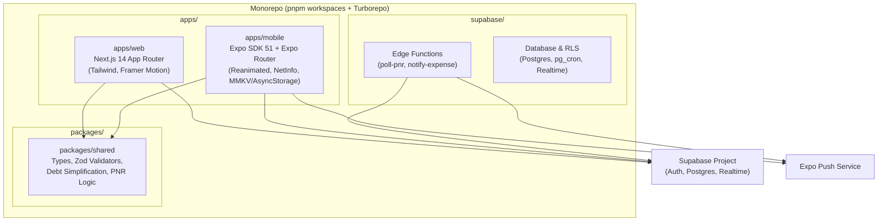

# Jal Khoj — Indian Railways Journey & Expense Planner

> A monorepo for group train travels across India. Track live PNR changes with split-flap status displays, coordinate organizer-guided itineraries, split group expenses with debt-simplification, settle debts instantly via UPI intent links, and access ticket details offline without cellular signal inside trains.

---

## Architecture Overview



### Directory Structure

```
trip-management/
├── apps/
│   ├── web/                    # Next.js 14 App Router web client
│   │   ├── src/app/
│   │   │   ├── (auth)/         # Magic link & Google auth
│   │   │   ├── trips/          # Trips dashboard & creation
│   │   │   │   └── [tripId]/   # 4 tabs: overview, trains, plan, money
│   │   │   └── join/[code]/    # Web invite code joining route
│   │   ├── src/components/     # TicketStub, SplitFlapDisplay, Modals
│   │   └── src/lib/supabase/   # SSR / client Supabase utilities
│   │
│   └── mobile/                 # Expo (React Native + TypeScript) Android client
│       ├── app/                # Expo Router file-based routes
│       │   ├── (auth)/login    # Mobile boarding pass login
│       │   ├── (app)/trips/    # Trips list + [tripId] tabs
│       │   │   └── [tripId]/   # Overview, trains, plan, money tabs
│       │   └── join/[code]     # Deep link handler (jalkhoj://join/CODE)
│       ├── src/components/     # Reanimated SplitFlapDisplay, TicketStub, SettleUpButton
│       ├── src/lib/offline/    # Local storage caching & offline sync queue
│       └── src/lib/            # Notifications, Supabase client
│
├── packages/
│   └── shared/                 # Shared TypeScript library
│       ├── src/types/          # Domain models, PNR codes, theme palette
│       ├── src/validators/     # Zod validation schemas
│       └── src/logic/          # Debt simplification, split math, PNR parsing
│
├── supabase/
│   ├── migrations/             # Complete schema, RLS, functions, pg_cron
│   ├── functions/
│   │   ├── poll-pnr/           # Automated PNR status polling & push dispatch
│   │   └── notify-expense/     # Push notification dispatch for expenses
│   └── config.toml             # Local Supabase development config
│
├── pnpm-workspace.yaml
├── turbo.json
├── package.json
└── README.md
```

---

## Features

### 1. Four Cohesive Tabs (Web & Mobile)
- **Overview**: Trip summary, dates, organizer badge, traveler roster, and 6-character invite code with shareable URL.
- **Trains**: Vintage Indian Railways ticket stubs with perforated visual styling, passenger breakdown (coach/berth/type), and split-flap station board.
- **Plan**: Day-by-day journey timeline. **Organizer-only editing** ensures only the designated trip leader can add, edit, or delete events.
- **Money**: Group expense tracker supporting equal, exact, percentage, and shares-based splits. Computes optimal net balances and minimizes transfer transactions with greedy debt-simplification.

### 2. Live PNR Alerts (Backend Engine)
- **Server-driven polling**: Supabase Edge Function scheduled via `pg_cron`.
- **Dynamic frequency**: Polls every 12 hours far from journey date, ramping up to every 30 minutes on the journey day.
- **Push alerts**: Dispatches Expo Push Notifications to all trip members on chart preparation (`Chart prepared for 12951`) and seat upgrades (`Ticket 2 moved from WL 5 to CNF (B3, 42)`).

### 3. Offline Support (Trains & Low-Signal Routes)
- Local caching of trip details, tickets, itinerary, and net balances.
- Passengers can inspect their coach/berth allocation and PNR details without an active network connection.
- **Offline Expense Queue**: Expenses logged while traveling through signal-dead zones are queued locally and automatically synchronized with Supabase once network connectivity is restored.

### 4. Settle Up via UPI
- Generates compliant `upi://pay` deep links pre-populated with payee VPA, traveler name, and exact amount in INR.
- Web: Opens UPI link or displays instant settlement details.
- Mobile: Launches the user's installed UPI app (Google Pay, PhonePe, Paytm, BHIM) in one tap.

---

## Prerequisites

- [Node.js](https://nodejs.org/) (v20+ recommended)
- [pnpm](https://pnpm.io/) (`corepack enable && corepack use pnpm@9.15.0`)
- [Expo CLI](https://docs.expo.dev/) & [EAS CLI](https://docs.expo.dev/eas-update/getting-started/) (`npm install -g eas-cli`)
- A [Supabase](https://supabase.com/) project (or local Supabase CLI)

---

## Setup & Local Development

### 1. Install Dependencies
```bash
pnpm install
```

### 2. Environment Variables
Copy `.env.example` to `.env.local` in the respective apps:

```bash
# apps/web/.env.local
NEXT_PUBLIC_SUPABASE_URL=https://your-project.supabase.co
NEXT_PUBLIC_SUPABASE_ANON_KEY=your-anon-key

# apps/mobile/.env
EXPO_PUBLIC_SUPABASE_URL=https://your-project.supabase.co
EXPO_PUBLIC_SUPABASE_ANON_KEY=your-anon-key
```

### 3. Database Migration
Apply the SQL migration to your Supabase project:
```bash
# Using Supabase CLI
supabase db push

# Or run supabase/migrations/20240101000000_initial_schema.sql directly in the Supabase SQL Editor.
```

### 4. Running the Web App
```bash
pnpm dev:web
# Accessible at http://localhost:3000
```

### 5. Running the Mobile App (Expo)
```bash
pnpm dev:mobile
# Or directly inside apps/mobile:
cd apps/mobile
pnpm start
```
- Press `a` to open in an Android Emulator.
- Scan the QR code with **Expo Go** on a physical Android phone.

---

## Running Unit Tests

The split calculations and debt-simplification algorithms in `packages/shared` are covered with comprehensive Vitest unit tests:

```bash
pnpm test:shared
```

Test coverage includes:
- Equal split rounding and remainder paise distribution.
- Proportional shares and percentage split calculations.
- Net balance graph generation from expenses and settlements.
- Debt-simplification minimizing transactions (e.g. 5-person complex triangles resolved to minimal payments).
- PNR string status parsing (`CNF/B3/42`, `WL/5`, `RAC/3`, `RLWL/12`).
- Journey date proximity polling interval calculations.
- Status change detection and push message formatting.

---

## Building an Android APK with EAS Build

The mobile application is pre-configured with `eas.json` to generate standalone APKs for direct installation on Android devices.

### Step 1: Install & Authenticate EAS CLI
```bash
npm install -g eas-cli
eas login
```

### Step 2: Configure EAS Project
Inside `apps/mobile`:
```bash
cd apps/mobile
eas project:init
```

### Step 3: Build Preview APK (Direct Installable APK)
Run the preview build profile configured in `apps/mobile/eas.json`:
```bash
eas build --platform android --profile preview
```
- EAS Build will bundle the app in the cloud.
- Once finished, a download link and QR code for the `.apk` file will be provided in the terminal.
- Download and install the APK directly on any Android smartphone.

### Step 4: Local APK Build (Alternative without Cloud Queue)
If you have Android Studio / Android SDK installed locally:
```bash
eas build --platform android --profile preview --local
```

---

## Deep Linking Configuration

- **Scheme**: `jalkhoj://join/{INVITE_CODE}` (or `yatra://join/{INVITE_CODE}`)
- **Universal / App Link**: `https://*.jalkhoj.app/join/{INVITE_CODE}`
- Testing deep links on Android emulator:
  ```bash
  npx uri-scheme open "jalkhoj://join/VNS26X" --android
  ```

---

## License
MIT License. Built for Indian Railways travelers.
